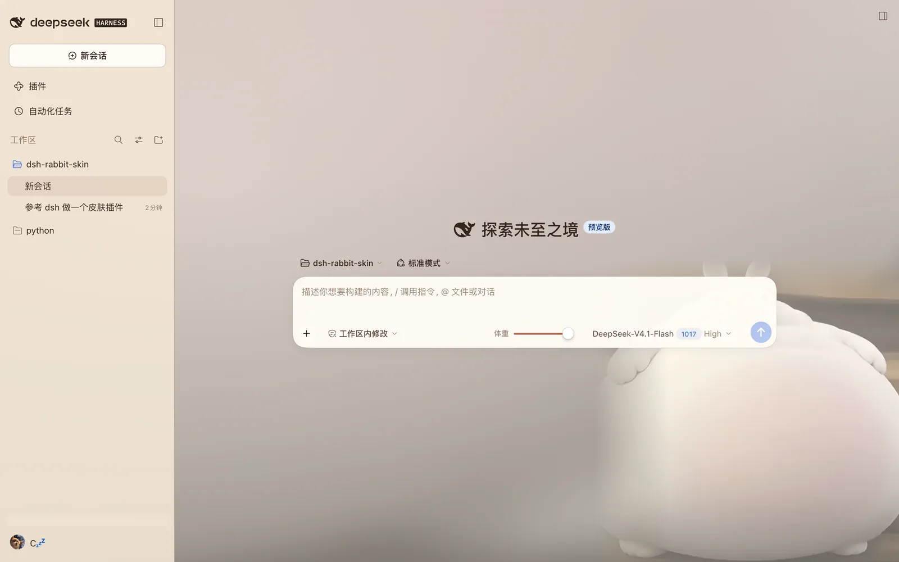
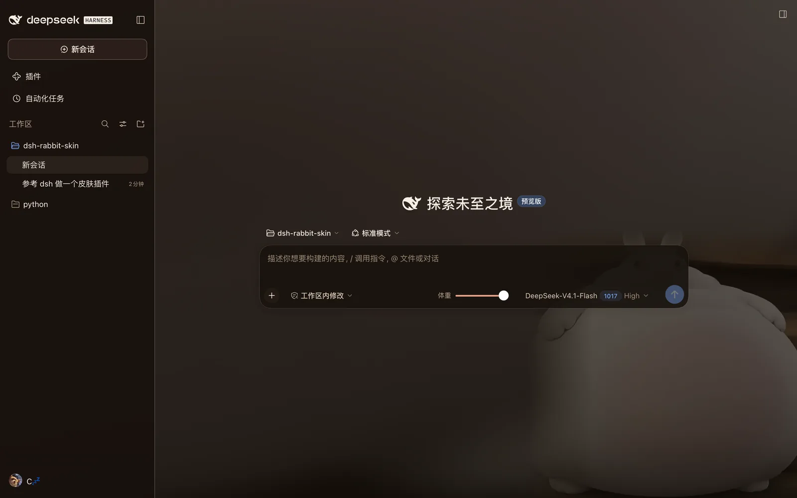
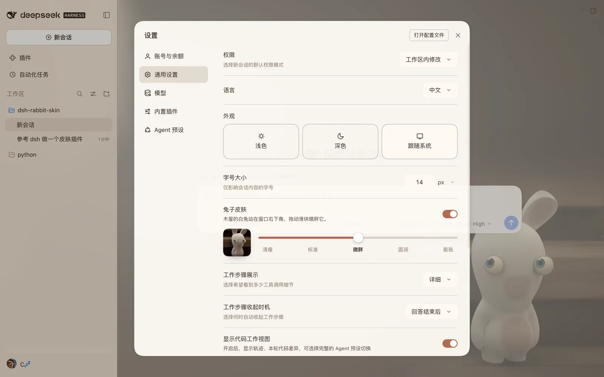

# 兔子皮肤 · dsh-rabbit-skin

把 DSH 的窗口换成木屋里的一只白兔：奶油色纸张叠在深棕木板上，兔子站在窗口右下角，
体重五档随你捏 —— 从清瘦到膨胀，一档一档喂。





- **五档体重**：设置 → 通用 → 「兔子皮肤」里拖滑块；输入框右侧还有一条同款的短滑块，随手就能拖。滑块本身不带图画，档位靠左边那张预览图看。
- **跟随明暗**：皮肤自带浅色/深色两套配色，通过主题的 token 图层生效，不会抢占你的 light/dark 偏好。
- **零资源路由**：五张图在构建时就内联进 bundle，Web 与桌面端走同一条路径，不依赖 `/plugins/...` 的资源 URL。

## 安装

**从 GitHub 装**（推荐）：

```bash
dsh plugin --profile web add github:drinkMornTea/dsh-rabbit-skin
# 桌面端把 profile 换成 desktop
```

**从 Release 的预构建包装**（免构建，最快）：

```bash
dsh plugin --profile desktop add https://github.com/drinkMornTea/dsh-rabbit-skin/releases/latest/download/dsh-rabbit-skin.tgz
```

**从插件市场装**：收录后它出现在 dsh-market 的「主题」页。也可以在 DSH 自带的
**插件 → 发现 → 索引源** 添加 `https://cdn.jsdelivr.net/npm/dsh-plugin-catalog/index.json`，
再搜 `兔子皮肤`。

DSH 的 Web 与桌面是两个独立 profile，装在哪个就只在哪个生效。**从本地目录装**：

```bash
# 桌面端
dsh plugin --profile desktop add /path/to/dsh-rabbit-skin

# 或者 Web 端
dsh plugin --profile web add /path/to/dsh-rabbit-skin
```

也可以先打包再装：

```bash
npm pack                                  # 产出 dsh-rabbit-skin-0.1.0.tgz
dsh plugin --profile desktop add ./dsh-rabbit-skin-0.1.0.tgz
```

安装会自动写进 profile 的 `dsh.profile.bundles`，重启 DSH 后生效。验证：

```bash
dsh --profile desktop --dump-config | grep -A2 rabbit-skin
```

卸载：

```bash
dsh plugin --profile desktop remove dsh-rabbit-skin
```

## 使用

1. 重启后打开 **设置 → 通用**，「外观」下面会多出「兔子皮肤」一行：右上角是开关，下面左边一张预览图、右边一条五档滑块。

   

2. 输入框右侧也会出现一条同一个滑块的短版本（前面标着「体重」）：两边共用一份状态，拖一边另一边立刻跟上。
3. 关掉开关，界面立刻恢复原样（token 图层撤走、背景层移除），偏好仍记着下次再开。

偏好存在 `localStorage` 的 `dsh-rabbit-skin:prefs`，形如 `{"enabled":true,"stage":2}`。

## 它是怎么做的

| 部分 | 做法 |
| --- | --- |
| 配色 | `theme.overrideTokens('dsh-rabbit-skin', TOKEN_LAYER)` 叠一层 alias token：每个 token 给 `{ light, dark }`，主题服务按当前配色方案取值，卸载时只撤掉这一层 |
| 背景 | `#dsh-rabbit-skin-art` 固定层，`z-index:-1`，`body[data-rabbit-skin="on"]` 控制显隐；壳层本来就是 `body{isolation:isolate; background:transparent}`，所以它能稳稳落在界面后面 |
| 构图 | 同一张图分三层画：`.rabbit-ambient` 取照片右下角的墙面、放大 240% 再 `blur(28px)` 铺满整屏当房间；`.rabbit-figure` 是右下角清晰的兔子，只把左边与上边蒙掉，让它融进虚化的房间而不是贴成一张方图；`.rabbit-veil` 是一层偏左的暖色渐变，保证文字栏下面的底子够干净 |
| 留白 | alias 里的 `bg-base` 只留 0.18 不透明度 —— 画布是唯一必须透明的表面，面板、侧栏、气泡各自带自己的填充，所以木屋才透得上来 |
| 图片 | `assets/rabbit-1..5.webp`（900px 宽，共约 60 KB）由 esbuild 的 `dataurl` loader 内联，桌面端 `file://` 页面也能显示 |
| 入口 | 两个正式槽位：`settings.general.item` 与 `conversation.input.right`，不依赖任何 CSS-module 哈希类名 |
| 控件 | 原生 `<input type="range">`（`min=0 max=4 step=1`），轨道用 `linear-gradient` 按 `--rabbit-progress` 填充，把手是标准的白色圆钮（不带图案）；键盘方向键、读屏的 `aria-valuetext`、禁用态都由浏览器负责 |
| 宿主 | `src/index.js` 只是占位 fiber（注册 id、不注入服务），皮肤全部在客户端 bundle 里 |

`src/client/` 一览：

- `art.ts` — 五档的顺序、内联图片、每档的取景焦点、`stageIndex()` 夹取
- `palette.ts` — token 图层（浅/深两套，外加两个 `--rabbit-*` 自用变量）
- `skin.ts` — 偏好存储（`useSyncExternalStore` 友好）、样式注入、art 层绘制、`startSkin(theme)`
- `ui.tsx` — 设置行与输入区滑块
- `strings.ts` — 中英文案与 `{name}` 插值（宿主没绑 `t` 时回退中文）
- `skin.css` — art 三层、设置行、滑块（轨道/把手/档位刻度）的样式

## 开发

```bash
npm install           # 只需要 esbuild
npm run build         # 构建 lib/client.js
npm test              # 用假 DOM / React / ModuleLoader 跑真实 bundle 的契约测试
npm run check         # build + test
```

本地联调：用 `dsh plugin --profile desktop add /path/to/dsh-rabbit-skin` 装成本地 link，
改完 `npm run build` 后重启 DSH 即可看到；不必反复安装。

## 兼容性

- 面向 DSH `0.2.x` 的客户端扩展点（`dsh.client` + `ctx.slots` + `ctx.theme`）。
- 只 require 基线模块（`react`、`react/jsx-runtime`、`@deepseek-ai/dsh-client-ui-primitives`），不额外请求任何非基线包。
- 皮肤只在 light/dark 之上叠 token 图层，不改「外观」里那三个内置选项，也不占用第三方主题 id，可以和别的主题插件共存。
- 不改宿主 DOM 结构、不写 `[class*="_xxx"]` 之类的脆弱选择器。

## License

MIT
